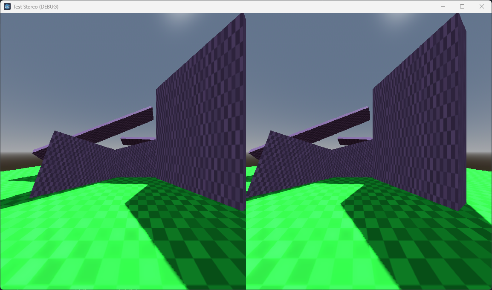
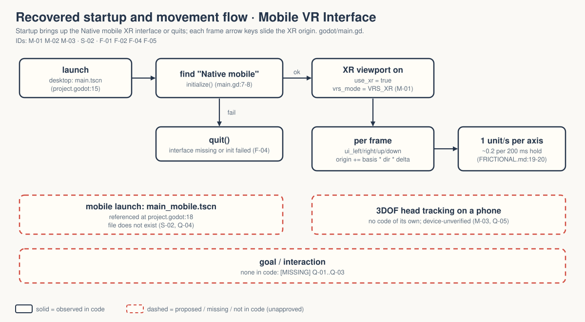

# walker-xr-mobile-vr-interface-demo — Game Design Document (recovered)

| | |
|---|---|
| Version | 0.1.0-recovered |
| Date | 2026-09-27 |
| Author | Zelda (agent, `/gdd reverse --path godot silent`), for Nik Bear Brown |
| Mode | recovered, silent |
| Revision | 1 |
| Gates | gate — unsigned at time of writing (vision ○ · systems ○ · world ○ · scope ○) |
| Source | `godot/` — Walker title-only copy of Godot demo `xr/mobile_vr_interface_demo`, commit `a3b5c113112f77291d5f3d1360f33a882fdc52f7` `[OBSERVED README.md:3-5]` |
| Engine | Godot 4.7.2 per `VERIFICATION.md:3`; features "4.7", "Forward Plus" but renderer set to GL Compatibility on desktop and mobile `[OBSERVED godot/project.godot:16,22-23]` |

Provenance tags: `[OBSERVED path:line]` the code or a file in this folder says this · `[INFERRED]` the code strongly implies it; evidence stated · `[MISSING]` nothing here can tell you; logged in `decisions.md`. Paths are relative to the folder root. Dashed elements in diagrams and deck are not in the code.

**What this document is.** A description of what exists, recovered from code. It is not an approved design. This project is an XR interface smoke test, not a game.

*Upstream screenshot shipped with the Godot demo (`godot/screenshots/mobile_vr_interface_demo.png`, referenced by `godot/README.md:26`). Not a Walker capture: desktop stereo pixels are unverified in Walker `[OBSERVED VERIFICATION.md:3-6,14]`.*

## 1. Vision summary

**What it is.** A room of a floor and five patterned wall blocks seen through an `XRCamera3D`. On startup the script initialises Godot's built-in "Native mobile" XR interface and switches the viewport to XR (stereo) rendering; if that fails, it quits. On desktop, the arrow keys slide the XR origin around. `[OBSERVED godot/main.gd:6-34; godot/main.tscn:39-72]`

**What it demonstrates.** "The simplest form for enabling and testing an XR application", with stereo rendering testable on desktop without XR hardware and simple 3DOF head tracking on mobile devices `[OBSERVED godot/README.md:3-5,15-18]`.

**Why it exists in Walker.** `[MISSING]` The folder records a title-only adaptation with two native-4K Liam films pending `[OBSERVED README.md:3,14]`. Q-01.

**Player / audience.** `[MISSING]` A user can move; there is nothing to do. Implied audience: developers checking that mobile VR stereo works `[INFERRED from godot/README.md:3-5]`. Q-02.

**Fantasy, logline, promise.** Not applicable. `[MISSING]` by design.

## 2. Design pillars

`[MISSING]` None stated. Engineering properties the code protects, as inferences:

- **Fail loudly, not silently.** No XR interface → the app quits instead of running flat `[OBSERVED godot/main.gd:17-19]`.
- **Hardware-free testing on desktop.** Arrow-key movement exists so stereo can be checked without a phone `[OBSERVED godot/README.md:4,18; godot/main.gd:21-34]`.

## 3. Core loop

**Startup.** `XRServer.find_interface("Native mobile")` → `initialize()` → `viewport.use_xr = true`, `vrs_mode = VRS_XR`; otherwise `get_tree().quit()` `[OBSERVED godot/main.gd:7-19]`. Lens-distortion overrides (`k1`, `k2`) are present but commented out `[OBSERVED godot/main.gd:9-11]`.

**Per frame.** Arrow keys (`ui_left/right/up/down`) set a direction; the origin moves along its own X and Z basis at 1 unit/s `[OBSERVED godot/main.gd:21-34]`. Walker measured ≈0.195–0.200 units per 200 ms hold, consistent with that `[OBSERVED FRICTIONAL.md:18-20]`.

**Meso / macro.** None. `[OBSERVED absence]`

**Loop honesty test.** Strip the stereo: a camera sliding past five boxes. Correct for a smoke test; nothing to decide. `[INFERRED]`

## 4. Player Experience Goals

`[MISSING]` None; no PX-xx IDs assigned. A viewer goal ("a developer sees a stable stereo pair and, on a phone, the view follows head rotation") is proposed in Q-02, not approved. Comfort in a headset is untested `[OBSERVED VERIFICATION.md:5-6]`.

## 5. Mechanics

### M-01 XR interface bring-up `[OBSERVED]`
`godot/main.gd:6-19` as above. Walker's harness observed `XR_INITIALIZED=true VIEWPORT_XR=true` on desktop `[OBSERVED FRICTIONAL.md:18]`.

### M-02 Desktop origin movement `[OBSERVED]`
Built-in `ui_*` actions; `elif` means left wins over right and up wins over down when both are held `[OBSERVED godot/main.gd:24-31]`. Speed 1 unit/s per axis; diagonal is √2 faster `[INFERRED from godot/main.gd:33-34, direction not normalised]`. Tuning values, not approved design.

### M-03 3DOF head tracking `[INFERRED, unverified]`
No code handles tracking; the upstream README says mobile devices can test simple 3DOF headtracking through the interface `[OBSERVED godot/README.md:5]`. It needs device validation and a valid mobile scene `[OBSERVED README.md:7-8; VERIFICATION.md:15-16]`.

## 6. Systems

### S-01 Scene composition `[OBSERVED godot/main.tscn:39-72]`
`Main` (Node3D + `main.gd`): shadowed DirectionalLight3D, WorldEnvironment, `XROrigin3D` → `XRCamera3D` at eye height 1.5, `Floor` plane, `Wall01`, `Wall02`, `Wall04` (BoxMesh 4×3×1 with `pattern.png`), `Wall03`, `Wall05` (instances of `wall.tscn`) `[OBSERVED godot/main.tscn; godot/wall.tscn:1-20]`.

### S-02 Platform scene selection `[OBSERVED]`
`run/main_scene="res://main.tscn"`; `run/main_scene.mobile="res://main_mobile.tscn"` `[OBSERVED godot/project.godot:15,18]`. **`main_mobile.tscn` does not exist** in the adaptation or the source inventory `[OBSERVED VERIFICATION.md:8-9; FRICTIONAL.md:10]`. On mobile the project points at a missing scene; no replacement has been made, on purpose `[OBSERVED VERIFICATION.md:12]`. Q-04.

### S-03 Render and XR settings `[OBSERVED godot/project.godot:16,20-29]`
Feature tag "Forward Plus" alongside `gl_compatibility` for desktop and mobile. OpenXR foveation level 3, dynamic; XR shaders enabled. OpenXR itself is not enabled; the demo uses the mobile interface `[OBSERVED godot/project.godot; godot/main.gd:7]`. The upstream README warns that lens distortion is not supported in the Compatibility renderer `[OBSERVED godot/README.md:20-22]`. Q-07.

No input map entries (built-in `ui_*` only), no collision, no save/load, no scene transitions `[OBSERVED absence]`.

## 7. Progression

Not applicable. `[MISSING]` by design.

## 8. World

A floor and five tilted wall blocks, purple-tinted pattern texture `[OBSERVED godot/main.tscn:54-72; godot/wall.tscn:5-8]`. A visual reference for depth, nothing more `[INFERRED]`.

## 9. Narrative

None; none invented. `[MISSING]` by design.

## 10. Characters

None.

## 11. Features and priority

| ID | Feature | Status | Priority | Evidence |
|---|---|---|---|---|
| F-01 | Native mobile XR interface + XR viewport | implemented; initialisation observed on desktop | CORE | `FRICTIONAL.md:18` |
| F-02 | Desktop arrow-key origin movement | implemented; 4 input-driven holds pass | CORE | `FRICTIONAL.md:18-20` |
| F-03 | Depth-reference room (floor + 5 walls) | implemented | SUPPORTING | S-01 |
| F-04 | Quit on XR failure | implemented | SUPPORTING | `godot/main.gd:17-19` |
| F-05 | Mobile main-scene override | **broken reference** (`main_mobile.tscn` absent) | SUPPORTING | S-02 |
| F-06 | Lens-distortion override | commented out | SUPPORTING (inactive) | `godot/main.gd:9-11` |
| F-07 | Desktop diagnostic `test_desktop.gd` (Walker addition) | implemented; exit 0 | TOOLING | `FRICTIONAL.md:15-21` |

**CORE: 2 of 7 = 29%**, under the 40% line.

## 12. Out of scope

Controllers, hand tracking, OpenXR runtimes, interaction, any content. `[INFERRED from absence]` The Walker copy did no SDK install, device deployment, account change or speculative mobile replacement `[OBSERVED VERIFICATION.md:12]`.

## 13. Technical

- Scenes: `godot/main.tscn` (main), `godot/wall.tscn`; missing `godot/main_mobile.tscn` (referenced). Scripts: `godot/main.gd`, `godot/test_desktop.gd` (diagnostic). See `IMPLEMENTATION-MAP.md`.
- Assets: `pattern.png` (1 texture), `icon.svg`; maturity L3 upstream demo art `[INFERRED]`.
- Verification on record: Godot 4.7.2 headless import and bounded 120-frame startup exit 0 `[OBSERVED FRICTIONAL.md:5; VERIFICATION.md:3]`. First harness had a parse failure on untyped `instantiate` inference despite exit 0; corrected in the harness only `[OBSERVED FRICTIONAL.md:16-18]`. Retest: `XR_INITIALIZED=true`, `VIEWPORT_XR=true`; Left/Right move X by −0.195/+0.194, Up/Down move Z by −0.200/+0.200 in 200 ms holds; explicit diagnostic XR teardown `[OBSERVED FRICTIONAL.md:18-21]`. No log files are stored in this folder; these numbers are recorded in `FRICTIONAL.md` only.
- Not verified: stereo pixels, lens, head tracking, device comfort, mobile launch `[OBSERVED VERIFICATION.md:5-6,14-16]`.

## 14. Risks

| ID | Risk | Likelihood | Impact | Mitigation |
|---|---|---|---|---|
| R-01 | Mobile export launches a missing scene | high on mobile | demo fails at start on the platform it is named for | Q-04 |
| R-02 | Desktop state checks read as stereo or tracking proof | medium | a claim nobody has seen | keep VERIFICATION.md wording; Q-05 |
| R-03 | Compatibility renderer shows no lens distortion | certain per upstream README | a phone-in-viewer shows the wrong image | Q-07 |
| R-04 | No log files kept; results only in prose | medium | results cannot be re-read or diffed | Q-08 |

## 15. Open questions

In `decisions.md`: Q-01 purpose, Q-02 audience, Q-03 demo or game, Q-04 missing mobile scene, Q-05 device validation, Q-06 film done, Q-07 renderer / lens distortion, Q-08 missing log files, Q-09 CORE (under limit).

## 16. Tests

Existing `[OBSERVED godot/test_desktop.gd]` (results in `FRICTIONAL.md:18-21`; no log file in the folder):

| ID | Check |
|---|---|
| T-01 | interface found and initialised; `root.use_xr` true |
| T-02 | Left, Right, Up, Down 200 ms holds each move the origin > 0.1 in the expected direction |
| T-03 | clean exit after explicit XR teardown |

Proposed (not written, not approved):

| ID | Check |
|---|---|
| T-04 | mobile export: scene exists and loads (blocked on Q-04) |
| T-05 | desktop GPU capture: left/right eye images differ by a plausible disparity |
| H-01 | a person on a phone rotates their head and reports that the view follows |

## Zelda's notes (silent mode; what I would have said out loud)

1. **Ghost Center — PRESENT, expected.** §1 "Why it exists in Walker" is `[MISSING]`.
2. **Mechanic Mirage — ABSENT by vacancy.**
3. **Implementation Void — PRESENT.** The platform the demo is named after points at a scene that does not exist (S-02). That is the unhappy path, and it is the main path on mobile.
4. **Priority Inflation — ABSENT.** 29% CORE.
5. **Novelist's Trap — ABSENT.**
6. **Completeness Fallacy — PARTIAL.** VERIFICATION.md already names the gaps well; the renderer/lens mismatch and the missing logs were not yet questions (Q-07, Q-08).
7. **Stagnant Artifact — ABSENT.** Revision 1, CHANGELOG started.

**First fix:** Q-04. A mobile VR demo that cannot launch on mobile needs a person to decide whether it is a desktop stereo demo or a mobile one.
